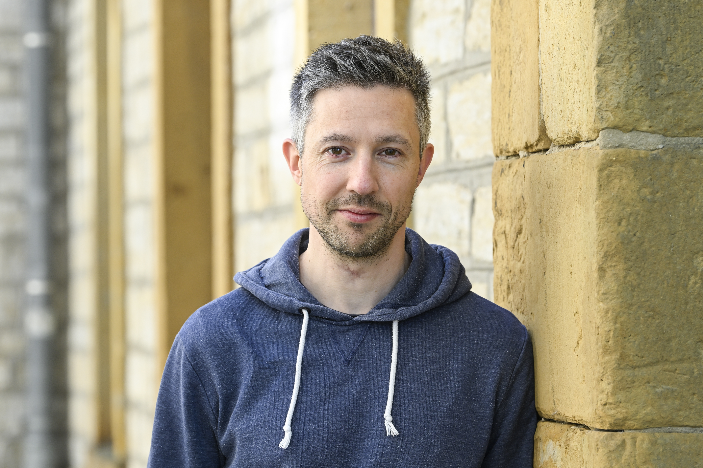

{width="513"}

Hallo und herzlich willkommen auf meiner Homepage!

Ich bin [Peter Pütz](uebermich.qmd) – promovierter Statistiker, Wissenschaftler und [Hypnose](hypnose.qmd)-Coach aus Bielefeld.

Auf dieser Seite findest Du zwei [Angebote](leistungen.qmd) von mir, die Dir helfen können, zu mehr Ruhe oder zu nachhaltiger Veränderung zu gelangen:

Mit meiner auf Dich zugeschnittenen Entspannungshypnose schenkst Du Dir eine Auszeit. Vielleicht bist Du gestresst, möchtest einfach mal abschalten oder Hypnose bewusst erleben? Ich nehme Dich mit auf eine entspannende Reise, bei der Du Kraft tankst und Neues entdeckst.

Im Hypnose-Coaching gehen wir gemeinsam Deine Ziele an: Ob Du alte Muster loslassen, mehr Leichtigkeit im Alltag finden oder konkrete Veränderungen umsetzen möchtest – ich unterstütze Dich mit einem klaren, lösungsorientierten Ansatz.

Ein besonderer Aspekt meiner Arbeit ist meine [Zufriedenheitsgarantie](preise.qmd): Wenn Du mit meiner Arbeit nicht zufrieden bist, erhältst Du Dein Geld zurück.

Schreibe mir einfach eine [Nachricht](kontakt.qmd). Ich freue mich auf ein unverbindliches Gespräch mit Dir.
